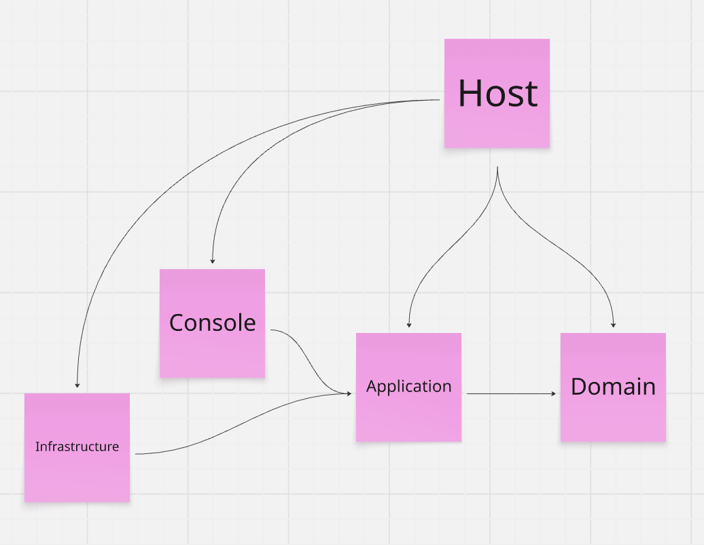
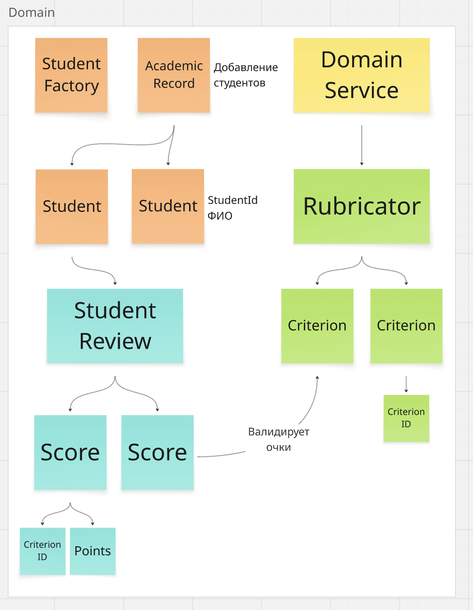
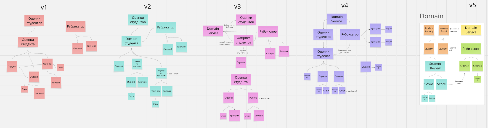

# Запуск
**Запуск с in-memory данными**
```
dotnet run src/HW2.Host
```

**Запуск с json**

Данные будут хранится в /data/ и будут сохраняться между сессиями (там уже есть данные, только некоторые фамилии я не нашёл)
```
dotnet run src/HW2.Host --storage json
```

**Запуск тестов**
```
dotnet run src/HW2.Tests
```

# Архитектура
Я использовал **Onion** с портами и адаптерами.


## Слои
1. **Domain** – тут находится бизнес-логика, вещи названы максимально приближенно к этому
    - Entity `Student`, `Criterion`, `Score`
    - Отдельные Value Object `StudentId`, `CriterionId`, `Points`
    - Агрегаты `AcademicRecord` (корень, внутри студенты и их `StudentReview`), `Rubricator` (корень, внутри критерии)


2. **Application** – набор use cases (по одному классу на сценарий), сам ничего не хранит
    - Порты `IStudentRepository`, `IRubricatorRepository`, `IFinalScoreExporter`
    - DTO `ExportData`, `ScoreData`, `CriterionData` и тд

3. **Infrastructure**
    - Экспорт в CSV/Json
    - Генераторы id для domain, которые следят за последним использованным индексом, счётчик ленивый
    - Адаптеры `CsvExporter`, `JsonExporter`
    - Репозитории `InMemory`, `Json`
    - DTO для `Json` и мапперы туда-обратно

4. **ConsoleUI** – часть инфраструктуры, просто вынес её в отдельный проект библиотекой. Реализацию частично взял с HW1 – каждая команда реализует `IMenuCommand`, из нового – ConsoleApp ловит ошибки, которые вызывает Domain и передаёт их пользователю, а не кладёт приложение.

5. **Host** – собирает логику вместе, запускается. Обрабатывает входной аргумент и регистрирует DI Container.

6. **Tests** – тестирует DomainService и инварианты
    - Балл $\geq$ 0 в `Points`
    - Балл $\leq$ max критерия в `Criterion.EnsureAccept`
    - Оценка только по критерию из рубрикатора в `StudentReview.AddScore`
    - там ещё есть

# Паттерны
- Порождающий: **Factory** `StudentFactory`, `CriterionFactory` в Domain – создают объекты с учётом их инвариантов и выдают индексы через порты `IStudentIdGenerator` и `ICriterionIdGenerator`

- Структурный: **Facade** `GradebookFacade` в Application – объединяет все конструкторы use cases в один, с которым супер удобно работать ConsoleUI

- Поведенческий: **Template Method** `FileWriteExporter` в Infrastructure – экспорт состоит из шагов `Convert` и `WriteToFile`, `CsvExporter` и `JsonExporter` меняют шаг преобразования под себя.

# Роль ИИ
Использовал идентично HW1: Попросил машину критиковать мои решения по архитектуре перед тем, как я приступал их писать, сам идеи не подкидывал. Помогал разбираться в C#.

